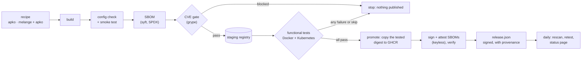

# wolfi-platform-images

Minimal container images built from [Wolfi](https://github.com/wolfi-dev) packages and
pinned upstream source, with three promises, measured every day:

- **Recently built.** Every package is pinned, locked and kept on the newest upstream
  release past a two-week cooldown. Components Wolfi lacks or ships stale are built
  from source with [melange](https://github.com/chainguard-dev/melange).
- **Secure.** Nothing is published with a CVE at or above `high` unless a written,
  expiring exception explains why it is unreachable. No shell, no package manager.
  Signed keylessly, with SBOM and build-provenance attestations.
- **Actually works.** Every image passes functional tests that run it for real
  before it is published, and what is published is exactly the digest that was tested.

[](https://jalijabe.github.io/wolfi-platform-images/)
[](https://jalijabe.github.io/wolfi-platform-images/)
[](https://jalijabe.github.io/wolfi-platform-images/)

**[Live status page →](https://jalijabe.github.io/wolfi-platform-images/)** (rescanned and retested daily)

| Image | Tag | Built from | Runs as | Fresh | Secure | Works |
|---|---|---|---|---|---|---|
| `haproxy` | `3.4.7-r1` | Wolfi `haproxy-3.4-nocaps` (LTS) | 65532 |  |  |  |
| `spire-server` | `1.15.5-r0` | source, [spiffe/spire](https://github.com/spiffe/spire) | 65532 |  |  |  |
| `spire-agent` | `1.15.5-r0` | source, [spiffe/spire](https://github.com/spiffe/spire) | root (workload attestation) |  |  |  |
| `spire-controller-manager` | `0.8.1-r0` | source, [spiffe/spire-controller-manager](https://github.com/spiffe/spire-controller-manager) | 65532 |  |  |  |
| `spiffe-csi-driver` | `0.3.0-r0` | source, [spiffe/spiffe-csi](https://github.com/spiffe/spiffe-csi) | root (CSI node plugin) |  |  |  |

Images are published to `ghcr.io/jalijabe/wolfi-platform-images/<image>:<tag>`
for `linux/amd64`. Other architectures can be added when a consumer needs them.

## What "actually works" means

The functional tests ([`tests/functional`](tests/functional)) run each image the
hardened way (read-only root filesystem, every capability dropped, no-new-privileges)
and check it does its job:

| Image | Tested by |
|---|---|
| `haproxy` | validating a configuration (and rejecting a broken one); proxying HTTP to a healthy backend; answering 503 for a dead one; serving its stats page; running every process as 65532; no shell in the image |
| `spire-server`, `spire-agent` | in Docker: the server's CA mints X.509-SVIDs; an agent attests with a join token; a registered workload gets its SPIFFE ID; an unregistered one gets none; an agent with a forged token is refused |
| all four SPIFFE images | on Kubernetes (kind): agents attest with projected service-account tokens; the CSI driver registers with the kubelet; the controller manager turns a `ClusterSPIFFEID` into entries; a labelled pod gets its SPIFFE ID through the CSI volume; an unlabelled pod gets none |

## Verify before you use

Every image is signed keylessly by the publish workflow and carries an SPDX SBOM
attestation for each architecture and a SLSA build-provenance attestation. Pin by
digest, and verify the exact signing identity:

```sh
IMAGE=ghcr.io/jalijabe/wolfi-platform-images/haproxy:3.4.7-r1
ID=https://github.com/jalijabe/wolfi-platform-images/.github/workflows/publish.yml@refs/heads/main
ISSUER=https://token.actions.githubusercontent.com

cosign verify --certificate-identity "$ID" --certificate-oidc-issuer "$ISSUER" "$IMAGE"
cosign verify-attestation --type spdxjson \
  --certificate-identity "$ID" --certificate-oidc-issuer "$ISSUER" \
  "ghcr.io/jalijabe/wolfi-platform-images/haproxy@$(crane digest --platform linux/amd64 "$IMAGE")"
gh attestation verify "oci://$IMAGE" --repo jalijabe/wolfi-platform-images
```

Each publish that builds something creates a [GitHub release](../../releases) with
`release.json`, listing every image's tag, index and per-platform digests, source
commit, CVE-gate summary and functional-test results, plus its Sigstore bundle, the
functional-test report and the SBOMs. Consume the
manifest rather than tags:

```sh
cosign verify-blob --bundle release.json.sigstore.json \
  --certificate-identity "$ID" --certificate-oidc-issuer "$ISSUER" release.json
```

## How an image is made



- **Pinned inputs.** Every Wolfi package is pinned in the recipe (`apko/*.yaml`)
  and, for Wolfi-only images, locked with checksums (`apko/*.lock.json`). Source
  builds (`melange/*.yaml`) pin the upstream tag and full commit, build with
  Wolfi's Go only (`GOTOOLCHAIN=local`), and bump vulnerable dependencies with
  melange `go/bump` where the gate requires it. Packages we build are named
  `<name>-src`, so scanners judge them by the Go modules inside them rather than
  by Wolfi's advisories for Wolfi's own builds of the same name. New tool,
  package and dependency versions must be at least two weeks old.
- **Checks.** The image config must have an entrypoint and run as the recipe's
  user (root only where `images.yaml` gives a `runAsRoot` reason). The smoke test
  runs the entrypoint from the image's own root filesystem through the image's
  own dynamic loader, so no container runtime is needed.
- **CVE gate.** Findings at or above `maxCveSeverity` (`high`) block publishing,
  whether or not a fix exists, unless [`cve-exceptions.yaml`](cve-exceptions.yaml)
  accepts that finding for that image with a written reason, an owner and an
  unexpired date. Findings of unknown severity are reported, not blocking.
- **Functional tests.** Every newly built image runs against real traffic or real
  peers before it can be published (above). `promote` refuses the whole release if
  any built image has a failing or skipped test, or none at all.
- **Sign.** Promotion copies the tested digest to GHCR (never a rebuild), then the
  publish workflow's GitHub OIDC identity gets a Fulcio certificate and each
  signature is recorded in Rekor. The index and every architecture's manifest are
  signed; each manifest gets its SBOM attestation.
- **Every day after.** The [status workflow](.github/workflows/status.yml) resolves
  the published digests, rescans them with a fresh vulnerability database, reruns
  the functional tests, checks upstream for newer releases, and updates the
  [status page](https://jalijabe.github.io/wolfi-platform-images/). Any image that needs attention turns the run red.

Public Wolfi does not keep every package current: `haproxy-3.2` stopped at 3.2.9
and `spire-server`/`spire-agent` at 1.15.1, each with fixes only in revisions it
does not publish. The gate catches this; the fix is a newer stream (HAProxy 3.4)
or a source build (SPIRE).

## Develop

Needs Go, [uv](https://docs.astral.sh/uv/), Node, [Task](https://taskfile.dev) and
Docker (source builds and functional tests; kind runs in Docker).

```sh
task tools                # pinned lint tools into .bin/; Python and Node environments
task lint                 # ruff, mypy, actionlint, gitleaks, Mermaid, images lint
task test                 # unit tests (offline)
task images:test          # stage every image, run the functional tests, verify (what CI runs)
task images:stage ONLY=haproxy   # just build, gate and stage one image
task images:functest      # functional tests against the staged images
task images:promote TARGET=localhost:5000 KEY=cosign.key   # publish tested images somewhere yourself
task status               # measure the published images and write the status site to .build/site
task ash                  # AWS Automated Security Helper scan
```

CI runs the same targets. Pull requests stage, gate and functionally test
everything but never sign for real or publish; [`publish.yml`](.github/workflows/publish.yml)
runs only from `main`.

## Updates

The [update workflow](.github/workflows/update.yml) runs every day (`task update`
locally). It finds:

- newer builds of every pinned Wolfi package, from Wolfi's package index;
- newer upstream releases of every source build, from GitHub (no drafts or
  prereleases), with the release tag's commit,

each **at least 14 days old**, and applies them: pins, tags, version annotations,
melange version, epoch and `expected-commit`, then re-locks and lints. It opens a
pull request listing every change and runs CI on it, which builds, CVE-gates and
functionally tests every image. Nothing is published unless that passes and the
pull request is merged; then the publish workflow builds only images whose tag is
new, tests them again on the staged digest, and promotes them.

To change an image by hand: edit the recipe and its tag in `images.yaml`, run
`task images:lock` (Wolfi-only recipes) and `task images:lint`, then
`task images:test` until the gate and the functional tests pass. A new image
needs functional tests in `tests/functional`, marked
`@pytest.mark.image("<name>")`: without passing ones it cannot be published.

## Security

See [SECURITY.md](SECURITY.md) to report a vulnerability.

## License

The recipes, factory code and workflows in this repository are licensed under
[Apache-2.0](LICENSE). The software inside each image keeps its own upstream
license (e.g. HAProxy: GPL-2.0-or-later; SPIRE: Apache-2.0), recorded in the
image's `org.opencontainers.image.licenses` annotation and its SBOM.
