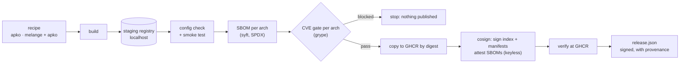

# wolfi-platform-images

Minimal container images built from [Wolfi](https://github.com/wolfi-dev) packages:
version-pinned, locked, scanned, SBOM'd and signed. No shell and no package
manager in the images. Components Wolfi lacks or ships stale are built from
source with [melange](https://github.com/chainguard-dev/melange).

| Image | Tag | Source | Runs as |
|---|---|---|---|
| `haproxy` | `3.4.7-r1` | Wolfi `haproxy-3.4-nocaps` (LTS) | 65532 |
| `spire-server` | `1.15.5-r0` | built from source ([spiffe/spire](https://github.com/spiffe/spire)) | 65532 |
| `spire-agent` | `1.15.5-r0` | built from source | root (workload attestation) |
| `spire-controller-manager` | `0.8.1-r0` | built from source | 65532 |
| `spiffe-csi-driver` | `0.3.0-r0` | built from source | root (CSI node plugin) |

Images are published to `ghcr.io/jalijabe/wolfi-platform-images/<image>:<tag>`
for `linux/amd64`. Other architectures can be added when a consumer needs them.

## Verify before you use

Every image is signed keylessly by the publish workflow and carries an SPDX SBOM
attestation for each architecture and a SLSA build-provenance attestation. Pin by
digest, and verify the exact signing identity:

```sh
IMAGE=ghcr.io/jalijabe/wolfi-platform-images/haproxy:3.4.7-r1
ID=https://github.com/jalijabe/wolfi-platform-images/.github/workflows/publish.yml@refs/heads/main
ISSUER=https://token.actions.githubusercontent.com

cosign verify --certificate-identity "$ID" --certificate-oidc-issuer "$ISSUER" "$IMAGE"
cosign verify-attestation --type spdxjson \
  --certificate-identity "$ID" --certificate-oidc-issuer "$ISSUER" \
  "ghcr.io/jalijabe/wolfi-platform-images/haproxy@$(crane digest --platform linux/amd64 "$IMAGE")"
gh attestation verify "oci://$IMAGE" --repo jalijabe/wolfi-platform-images
```

Each publish that builds something creates a [GitHub release](../../releases) with
`release.json`, listing every image's tag, index and per-platform digests, source
commit and CVE-gate summary, plus its Sigstore bundle and the SBOMs. Consume the
manifest rather than tags:

```sh
cosign verify-blob --bundle release.json.sigstore.json \
  --certificate-identity "$ID" --certificate-oidc-issuer "$ISSUER" release.json
```

## How an image is made



- **Pinned inputs.** Every Wolfi package is pinned in the recipe (`apko/*.yaml`)
  and, for Wolfi-only images, locked with checksums (`apko/*.lock.json`). Source
  builds (`melange/*.yaml`) pin the upstream tag and full commit, build with
  Wolfi's Go only (`GOTOOLCHAIN=local`), and bump vulnerable dependencies with
  melange `go/bump` where the gate requires it. Packages we build are named
  `<name>-src`, so scanners judge them by the Go modules inside them rather than
  by Wolfi's advisories for Wolfi's own builds of the same name. New tool,
  package and dependency versions must be at least two weeks old.
- **Checks.** The image config must have an entrypoint and run as the recipe's
  user (root only where `images.yaml` gives a `runAsRoot` reason). The smoke test
  runs the entrypoint from the image's own root filesystem through the image's
  own dynamic loader, so no container runtime is needed.
- **CVE gate.** Findings at or above `maxCveSeverity` (`high`) block publishing,
  whether or not a fix exists, unless [`cve-exceptions.yaml`](cve-exceptions.yaml)
  accepts that finding for that image with a written reason, an owner and an
  unexpired date. Findings of unknown severity are reported, not blocking.
- **Sign.** Keyless: the publish workflow's GitHub OIDC identity gets a Fulcio
  certificate and each signature is recorded in Rekor. The index and every
  architecture's manifest are signed; each manifest gets its SBOM attestation.

Public Wolfi does not keep every package current: `haproxy-3.2` stopped at 3.2.9
and `spire-server`/`spire-agent` at 1.15.1, each with fixes only in revisions it
does not publish. The gate catches this; the fix is a newer stream (HAProxy 3.4)
or a source build (SPIRE).

## Develop

Needs Go, [uv](https://docs.astral.sh/uv/), Node, [Task](https://taskfile.dev) and,
for source builds, Docker.

```sh
task tools                        # pinned lint tools into .bin/; Python and Node environments
task lint                         # ruff, mypy, actionlint, gitleaks, Mermaid, images lint
task test                         # unit tests (offline)
task images:test                  # build, gate, sign with a throwaway key, publish locally, verify
FACTORY_DOCKER=1 task images:test # + the melange source builds
task images:build ONLY=haproxy TARGET=localhost:5000 KEY=cosign.key   # publish somewhere yourself
task ash                          # AWS Automated Security Helper scan
```

CI runs the same targets. Pull requests build and gate everything but never sign
or publish; [`publish.yml`](.github/workflows/publish.yml) runs only from `main`.

## Update an image

1. Bump the version in the recipe (`apko/…` pin and `org.opencontainers.image.version`
   annotation, or `melange/…` version, epoch and `expected-commit`) and the tag in
   `images.yaml`.
2. `task images:lock` for Wolfi-only recipes, then `task images:lint`.
3. `FACTORY_DOCKER=1 task images:test` until the gate passes.
4. Open a pull request. After merge, the publish workflow builds only images whose
   tag is not yet published and signed.

## Security

See [SECURITY.md](SECURITY.md) to report a vulnerability.

## License

The recipes, factory code and workflows in this repository are licensed under
[Apache-2.0](LICENSE). The software inside each image keeps its own upstream
license (e.g. HAProxy: GPL-2.0-or-later; SPIRE: Apache-2.0), recorded in the
image's `org.opencontainers.image.licenses` annotation and its SBOM.
